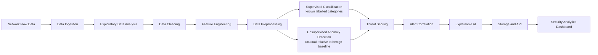

# Architecture

## System boundary

Network Intrusion Detection & Anomaly Intelligence is an offline research and analytics platform for network flow datasets. The initial benchmark is CIC-IDS2017. The system does not perform inline packet blocking, continuous production monitoring, or intrusion prevention.

The current implementation provides configuration, logging setup, CSV ingestion, EDA, Phase 04 data cleaning, and Phase 05 feature-contract/preprocessing infrastructure. Model training, detection, explainability, threat intelligence, API, and dashboard components remain planned.

## Intended processing pipeline

The supervised classifier learns labelled categories and predicts among known classes. The anomaly detector is a separate component trained to characterize benign traffic and identify unusual flows. An anomaly score is not a probability of compromise. The engines may supply separate signals to threat scoring, but their training, evaluation, outputs, and limitations remain distinct.

## Component responsibilities

| Component | Responsibility | Planned location |
|---|---|---|
| Configuration | Read TOML defaults and environment overrides; resolve paths from the project root | `src/intrusion_intelligence/config.py`, `configs/` |
| Logging and errors | Provide a shared console logging setup and common application exception types | `src/intrusion_intelligence/logging_config.py`, `errors.py` |
| Data ingestion | Discover CSVs, inspect source headers and checksums, compare schemas, load compatible files, stream chunks, and write JSON/Markdown reports without applying model transforms | `src/intrusion_intelligence/ingestion/` |
| Exploratory data analysis | Reuse ingestion, compute chunked full-scan summaries, deterministic samples, leakage/data-quality diagnostics, plots, and reports | `src/intrusion_intelligence/eda/`, `notebooks/01_dataset_exploration.ipynb` |
| Cleaning and leakage prevention | Assess values in chunks, normalize schemas and labels, canonicalize missing/infinite numeric values, quarantine unusable labels, separate feature policy from metadata, and publish verified Parquet outputs | `src/intrusion_intelligence/preprocessing/`, `notebooks/02_data_cleaning.ipynb` |
| Feature engineering | Load the feature contract, separate X/y/metadata, validate schema, and add optional deterministic flow features | `src/intrusion_intelligence/feature_engineering/`, `configs/feature_schema.json` |
| Model preprocessing | Fit median imputers, categorical encoders, profile-specific scalers, and optional selectors on training X; persist reusable artifacts | `src/intrusion_intelligence/preprocessing/`, `configs/preprocessing.toml` |
| Supervised classifier | Train/evaluate predictions for known labelled categories | `models/classification/` |
| Anomaly detector | Learn benign traffic patterns and produce anomaly scores separately | `models/anomaly_detection/` |
| Evaluation | Record metrics, split strategy, feature schema, and model version metadata | `evaluation/` |
| Threat intelligence | Combine explicitly named detection signals into scores and correlated alerts | `intelligence/` |
| Explainability | Explain classifier decisions and, where appropriate, anomaly outputs | `explainability/` |
| Services and persistence | Reusable inference/analytics interfaces and future database access | `services/`, `database/` |
| API and dashboard | Expose services and render actual analysis results | `api/`, `dashboard/` |

Dataset ingestion must not depend on preprocessing. Feature engineering must not contain model-training logic. The preprocessing API accepts feature-only X and refuses target labels; fitted transformations are reused unchanged for validation, held-out, inference, and batch input. Supervised and anomaly profiles have independent configurations and fitted objects. Backend request handlers must call services rather than train models. The dashboard will use defined service/API interfaces. Database configuration exists as an interface only; no connection code is active.

### Source header identity

Ingestion keeps each exact CSV header string and its source position in metadata. If duplicate or whitespace-normalized names make a DataFrame column ambiguous, ingestion assigns internal names that include the 1-based source position, such as `Fwd Header Length [source column 35]`. This preserves every source field and allows traceability without changing raw headers. Schemas with such collisions must have identical source order across files; order-based alignment is rejected for those groups. Label matching uses a trimmed, case-insensitive comparison while preserving the original label header and values. CIC-IDS2017's repeated `Fwd Header Length` fields were identical across 2,830,743 rows, but both remain in the ingested frame.

## Configuration and reproducibility

`configs/project.toml` holds safe defaults for raw/interim/processed data, dataset identity and source, supported CSV extensions, label-header candidates, encoding, chunk size, metadata/report locations, model artifacts, random seed, logging, database, and application settings. EDA reports use `NII_EDA_REPORT_DIR`; figures go under the configured report-figures root. Environment variables take precedence for local paths and sensitive values. The supported database override is `NII_DATABASE_URL`; the connection string must remain outside tracked files. The configuration loader does not load `.env` automatically or connect to a database.

Relative paths resolve from the project root. The configured random seed is a shared experiment setting, not a promise that every future algorithm is deterministic. Future experiment records should also capture dependency versions, data inputs, split definitions, and model/preprocessing artifact versions.

## Data and evaluation constraints

Future ingestion and model work must account for:

- Duplicate flows and duplicate feature vectors, including possible cross-split contamination.
- Missing values, positive/negative infinity, inconsistent types, and conflicting labels.
- Leakage through labels, Flow ID, IP addresses, timestamps, or other identifiers unavailable at inference.
- Severe class imbalance and suitable per-class/precision-recall reporting.
- Temporal and group-aware evaluation rather than relying only on random row splits.
- Unknown attack categories and the limits of predictions restricted to known classes.
- A consistent, versioned feature schema and reproducible fitted preprocessing between training and inference.
- Model artifact versioning with training-data and experiment metadata.

Raw benchmark files remain unchanged. Transformations should write to interim or processed storage and document the assumptions used.

## Storage and artifact policy

Large datasets belong in `data/raw/`, `data/interim/`, or `data/processed/`; model files belong in `models/`; generated figures and evaluation output belong in `reports/`. Raw data are never modified. Phase 04 writes normalized Parquet files, manifests, transformation history, label validation, and feature policy under `data/processed/CIC-IDS2017-phase04-v2/`; rejected rows go under `data/interim/quarantine/`; quality and cleaning reports go under `reports/data_quality/`. `.gitkeep` markers preserve the intended directory layout. Secrets, virtual environments, caches, and temporary outputs are also excluded.

## Dependency strategy

The default requirements install `data`, `eda`, `parquet`, `preprocessing`, and `dev` extras. Pandas and NumPy are in `data`; Matplotlib is in `eda`; PyArrow is in `parquet`; Scikit-learn and Joblib are in `preprocessing`. The broader `ml` extra remains optional and includes later model libraries; API, database, dashboard, and network dependencies also remain optional. Docker and Docker Compose are deferred until there is an executable application runtime to package.

## Current implementation status

Implemented: typed configuration and ingestion, EDA, Phase 04 chunked cleaning, and Phase 05 feature engineering/preprocessing. Phase 05 provides a versioned schema for the actual 78 numeric CIC-IDS2017 features, separate target and metadata extraction, strict schema/type validation, optional derived packet/byte features, train-fitted median and categorical imputation, numeric protocol-safe one-hot encoding, independent StandardScaler/none/RobustScaler profiles, optional train-fitted variance selection, training-only class weighting, batch transforms, versioned Joblib artifacts, transformed-matrix storage, and a bounded demonstration notebook. Synthetic fixtures cover feature leakage, train-only fitting, inference consistency, persistence, and row alignment.

The Phase 05 real-data check verified matching 83-column Parquet schemas across the eight Phase 04 outputs and fitted/transformed an illustrative 8,000-row sample only. No complete-dataset transformation, authoritative artifact, final split, model, model metric, anomaly baseline, threat score, alert, database connection, API endpoint, or dashboard view has been created.
