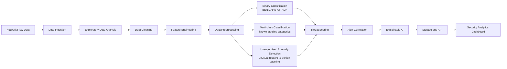

# Architecture

## System boundary

Network Intrusion Detection & Anomaly Intelligence is an offline research and analytics platform for network flow datasets. The initial benchmark is CIC-IDS2017. The system does not perform inline packet blocking, continuous production monitoring, or intrusion prevention.

The current implementation provides configuration, logging setup, CSV ingestion, EDA, Phase 04 data cleaning, Phase 05 feature-contract/preprocessing infrastructure, Phase 06 binary classification with Random Forest and Logistic Regression comparison, Phase 07 supervised multi-class classification, Phase 08 unsupervised anomaly detection, Phase 09 threat intelligence and alert correlation, Phase 10 explainability, Phase 11 model evaluation, Phase 12 API, Phase 13 dashboard, and Phase 14 integration in progress. Phase 14 adds persisted event retrieval and dataset-backed event SHAP to the API and dashboard without adding training or modifying source data.

## Intended processing pipeline

The supervised classifier learns labelled categories and predicts among known classes. The anomaly detector is a separate component trained to characterize benign traffic and identify unusual flows. An anomaly score is not a probability of compromise. The engines may supply separate signals to threat scoring, but their training, evaluation, outputs, and limitations remain distinct.

## Component responsibilities

| Component | Responsibility | Location |
|---|---|---|
| Configuration | Read TOML defaults and environment overrides; resolve paths from the project root | `src/intrusion_intelligence/config.py`, `configs/` |
| Logging and errors | Provide a shared console logging setup and common application exception types | `src/intrusion_intelligence/logging_config.py`, `errors.py` |
| Data ingestion | Discover CSVs, inspect source headers and checksums, compare schemas, load compatible files, stream chunks, and write JSON/Markdown reports without applying model transforms | `src/intrusion_intelligence/ingestion/` |
| Exploratory data analysis | Reuse ingestion, compute chunked full-scan summaries, deterministic samples, leakage/data-quality diagnostics, plots, and reports | `src/intrusion_intelligence/eda/`, `notebooks/01_dataset_exploration.ipynb` |
| Cleaning and leakage prevention | Assess values in chunks, normalize schemas and labels, canonicalize missing/infinite numeric values, quarantine unusable labels, separate feature policy from metadata, and publish verified Parquet outputs | `src/intrusion_intelligence/preprocessing/`, `notebooks/02_data_cleaning.ipynb` |
| Feature engineering | Load the feature contract, separate X/y/metadata, validate schema, and add optional deterministic flow features | `src/intrusion_intelligence/feature_engineering/`, `configs/feature_schema.json` |
| Model preprocessing | Fit median imputers, categorical encoders, profile-specific scalers, and optional selectors on training X; persist reusable artifacts | `src/intrusion_intelligence/preprocessing/`, `configs/preprocessing.toml` |
| Supervised classifier | Validate the original taxonomy, split and audit groups, train/evaluate known labelled categories, persist model/preprocessor pairs, and return original labels at inference | `src/intrusion_intelligence/multiclass/`, `models/supervised/multiclass/` |
| Binary classifier | Map original `BENIGN` to 0 and every non-benign original class to `ATTACK` without modifying source labels; compare Random Forest and Logistic Regression with train-only preprocessing and capture-day/source-file partitions, exclude evaluation-overlapping feature vectors from fit data, persist separate checksummed bundles, and expose batch inference | `src/intrusion_intelligence/binary/`, `models/supervised/binary/` |
| Anomaly detector | Fit a benign-only baseline, calibrate external thresholds on benign validation scores, and produce separately versioned anomaly decisions | `src/intrusion_intelligence/anomaly/`, `models/unsupervised/isolation_forest/` |
| Evaluation | Record split-aware binary and multi-class metrics, per-class errors, confusion matrices, feature schema, and model version metadata | `reports/evaluation/`, `reports/experiments/` |
| Threat intelligence | Normalize detector evidence, calculate traceable prioritization scores, create flow events, apply metadata-aware correlation, and generate alerts and reports | `src/intrusion_intelligence/intelligence/`, `configs/intelligence.toml` |
| Explainability | Produce offline reports and on-demand event-level SHAP for validated detectors, exact preprocessing, and training-only backgrounds | `src/intrusion_intelligence/explainability/`, `api/services/event_explanation_service.py` |
| Services and persistence | Validate datasets, call registered predictors, persist jobs/events/alerts and cached event-level SHAP, and summarize metrics/traffic | `api/services/`, `api/database/` |
| API | Expose bounded dataset, model, analysis, job, event, explanation, alert, metrics, traffic, health, and readiness routes | `api/routes/`, `api/schemas.py` |
| Dashboard | Render supported API summaries, retrieve events and model explanations, upload contract-valid CSVs, submit jobs, manage alerts, and export returned alert rows locally | `dashboard/` |

Dataset ingestion must not depend on preprocessing. Feature engineering must not contain model-training logic. The preprocessing API accepts feature-only X and refuses target labels; fitted transformations are reused unchanged for validation, held-out, inference, and batch input. Supervised and anomaly profiles have independent configurations and fitted objects. Backend request handlers call services rather than train models. Dataset-backed analysis records stable row references; event explanations re-read one row from the unchanged uploaded CSV and persist actual SHAP output on its event. PostgreSQL is the configured backend runtime database; SQLite is supported for isolated validation and tests. The API does not provide authentication or live packet capture.

### Source header identity

Ingestion keeps each exact CSV header string and its source position in metadata. If duplicate or whitespace-normalized names make a DataFrame column ambiguous, ingestion assigns internal names that include the 1-based source position, such as `Fwd Header Length [source column 35]`. This preserves every source field and allows traceability without changing raw headers. Schemas with such collisions must have identical source order across files; order-based alignment is rejected for those groups. Label matching uses a trimmed, case-insensitive comparison while preserving the original label header and values. CIC-IDS2017's repeated `Fwd Header Length` fields were identical across 2,830,743 rows, but both remain in the ingested frame.

### Phase 09 intelligence boundary

The intelligence layer reuses saved Phase 06, Phase 07, and Phase 08 batch predictors and checks their feature-schema versions and ordered input names against Phase 05. Model outputs remain separate evidence records; raw scores, decisions, versions, and availability are preserved. Normalized evidence feeds a configurable weighted heuristic score, severity bands, flow-level events, metadata-aware temporal correlation, alerts, and run reports. The score is a prioritization value, not a probability of compromise. Held-out labels are read into a separate offline-evaluation path after predictions and alerts are generated; they never enter feature matrices, event records, scoring, or alert rules.

For CIC-IDS2017, Phase 04 retains source file, source row, record ID, and destination port but not timestamp, IP endpoints, source port, protocol, or Flow ID. Destination port remains a predictive feature and is copied to investigation context only after model inference. Each event records metadata availability and provenance. Since all configured correlation rules require a timezone-aware timestamp, real data cannot form temporal groups; no timestamp is inferred from row order. The bounded Phase 09 run generates individual research alerts and records per-rule skip reasons. See `docs/threat_intelligence.md` and `docs/alert_correlation.md`.

## Configuration and reproducibility

`configs/project.toml` holds safe defaults for raw/interim/processed data, dataset identity and source, supported CSV extensions, label-header candidates, encoding, chunk size, metadata/report locations, model artifacts, random seed, logging, database, and application settings. EDA reports use `NII_EDA_REPORT_DIR`; figures go under the configured report-figures root. Environment variables take precedence for local paths and sensitive values. The supported database override is `NII_DATABASE_URL`; the connection string must remain outside tracked files. The configuration loader does not load `.env` automatically or connect to a database.

Relative paths resolve from the project root. The configured random seed is a shared experiment setting, not a promise that every future algorithm is deterministic. Future experiment records should also capture dependency versions, data inputs, split definitions, and model/preprocessing artifact versions.

## Data and evaluation constraints

Future ingestion and model work must account for:

- Duplicate flows and duplicate feature vectors, including possible cross-split contamination.
- Missing values, positive/negative infinity, inconsistent types, and conflicting labels.
- Leakage through labels, Flow ID, IP addresses, timestamps, or other identifiers unavailable at inference.
- Severe class imbalance and suitable per-class/precision-recall reporting.
- Temporal and group-aware evaluation rather than relying only on random row splits.
- Unknown attack categories and the limits of predictions restricted to known classes.
- A consistent, versioned feature schema and reproducible fitted preprocessing between training and inference.
- Model artifact versioning with training-data and experiment metadata.

Raw benchmark files remain unchanged. Transformations should write to interim or processed storage and document the assumptions used.

## Storage and artifact policy

Large datasets belong in `data/raw/`, `data/interim/`, or `data/processed/`; model files belong in `models/`; generated figures and evaluation output belong in `reports/`. Raw data are never modified. Phase 04 writes normalized Parquet files, manifests, transformation history, label validation, and feature policy under `data/processed/CIC-IDS2017-phase04-v2/`; rejected rows go under `data/interim/quarantine/`; quality and cleaning reports go under `reports/data_quality/`. `.gitkeep` markers preserve the intended directory layout. Secrets, virtual environments, caches, and temporary outputs are also excluded.

## Dependency strategy

The default requirements install `data`, `eda`, `parquet`, `preprocessing`, and `dev` extras. Pandas and NumPy are in `data`; Matplotlib is in `eda`; PyArrow is in `parquet`; Scikit-learn and Joblib are in `preprocessing`. The broader `ml` extra remains optional and includes later model libraries; API, database, dashboard, and network dependencies also remain optional. Docker Compose packages the API runtime and PostgreSQL service; the dashboard runs locally with its `dashboard` extra.

## Current implementation status

Implemented: typed configuration and ingestion, EDA, Phase 04 chunked cleaning, Phase 05 feature engineering/preprocessing, Phase 06 binary Random Forest and Logistic Regression comparison, Phase 07 multi-class classification, Phase 08 anomaly detection, Phase 09 threat intelligence/correlation, Phase 10 offline and event-level explainability, Phase 12 FastAPI/PostgreSQL services, Phase 13 Streamlit dashboard, and Phase 14 SQLite-verified integration (PostgreSQL validation outstanding). Phase 06 uses Monday–Wednesday training, Thursday validation, Friday test, train-only preprocessing, duplicate-vector screening across evaluation boundaries, a fixed threshold, and separately checksummed versioned predictors. The Friday comparison is documented in `docs/binary_classification.md`; neither model is promoted automatically because their precision/false-positive tradeoffs differ. Phase 09 adds all three detector families, optional metadata provenance, six correlation rules, separate offline alert evaluation, and JSON/JSONL/CSV/Markdown reporting. Synthetic fixtures cover evidence validation, score behavior, timezone handling, correlation eligibility, duplicate events, alerting, and idempotency.

Phase 07 results remain exploratory because the stratified row split overlaps source files. Phase 08 uses capture-day separation but has cross-day duplicate-vector links and measured Friday shift. Phase 09 CLI run `20261103T160444Z` integrated persisted binary v1.0.1, multi-class, and anomaly predictors on 3,000 deterministic stratified Friday rows. Its separate offline evaluation observed 1,500 benign and 1,500 attack rows across Bot, DDoS, and PortScan; binary recall was 0.2133 and event-alert recall 0.5753. Alert precision was 0.9908. The equal-weight sensitivity case had higher recall on this one bounded sample than defaults, but defaults remain unchanged because this is not sufficient independent evidence for weight selection. All 1,407 suspicious events lacked timestamps; endpoint metadata was also unavailable, and no correlation groups were formed. Dashboard scope and API limitations are described in `docs/dashboard_architecture.md`.
